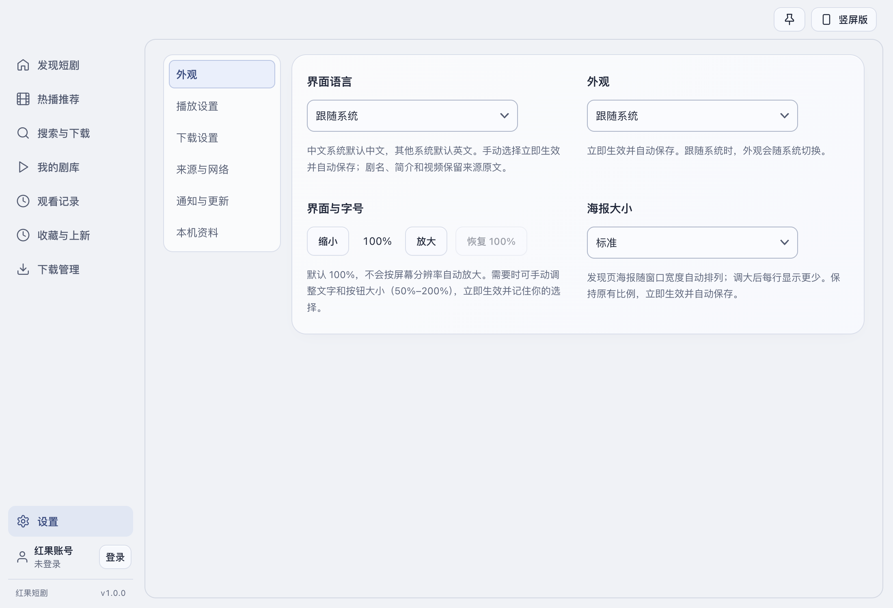

# 红果短剧桌面版

本项目基于 [jackotom/hongguo-drama](https://github.com/jackotom/hongguo-drama) 修改。感谢原作者 jackotom 和原项目贡献者。

## 1.0.3 更新内容

- 优化应用内更新。支持的版本可自动下载新版，在播放和任务空闲时安装并重启。

[1.0.3 更新说明](docs/release-notes/1.0.3.md)

## 1.0.2 更新内容

- 调整发现、搜索、播放器、观看记录、下载管理和设置的桌面布局。
- 观看记录支持调整卡片大小，并可在页面内同步账号记录。
- 横屏播放器的投屏入口移到顶部。Mac 支持在应用内下载新版安装包并打开。

[1.0.2 更新说明](docs/release-notes/1.0.2.md)

## 1.0.1 更新内容

- 登录二维码显示剩余有效期，到期自动换码。侧栏的「我的剧库」更名为「播放器」，设置移除了「本机资料」。

## 1.0.0 首发功能

- **雾白界面**。重新排布发现短剧、搜索、播放、观看记录、下载管理和设置，保留深色模式与竖屏布局。
- **更顺手的播放器**。选集和清晰度菜单从各自按钮上方打开，支持在多季短剧间切换，并从上次进度继续播放。
- **手机与电脑续看**。登录红果账号后，手机和电脑的观看记录合并显示。同一部剧按最后观看时间保留较新的断点。观看记录默认用卡片展示，也可切换成列表。
- **更简单的登录入口**。在侧栏「设置」下方点击「登录」，弹窗会自动加载二维码。登录状态和操作按钮同行，退出账号后仍可查看已保存的记录。
- **更新入口**。应用内检查更新指向本项目的发布页。

## 应用截图

### 发现短剧

### 外观设置

## 下载

Apple 芯片 Mac、Intel Mac、Windows x64 和 Linux x64 的最新安装包见 [本项目发布页](https://github.com/yuangy1995/hongguo/releases/latest)。

**Android 手机 APK／Android TV 版**由 [N3urda/hongguoTV](https://github.com/N3urda/hongguoTV) 独立维护。

[GPL-3.0 许可证](LICENSE)
